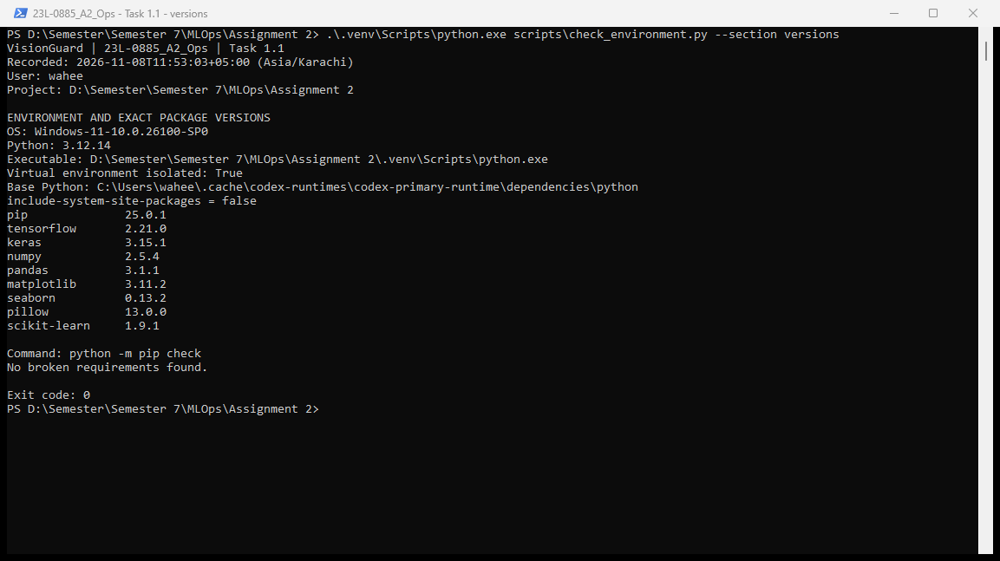
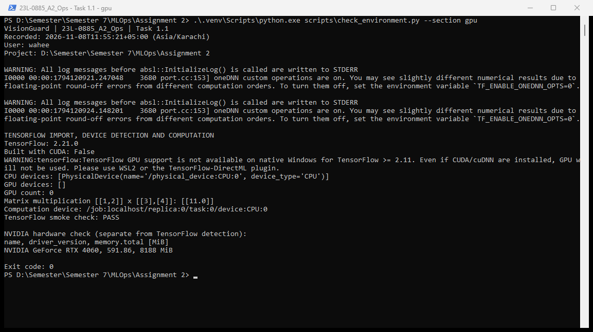
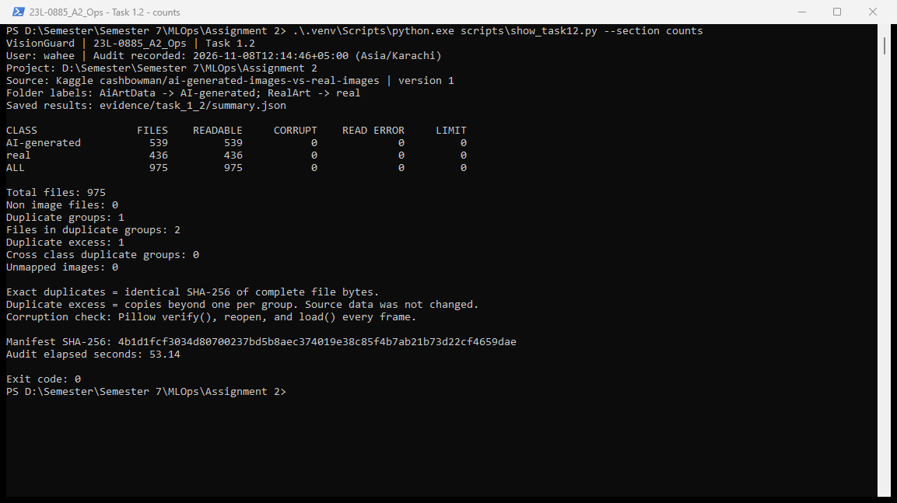
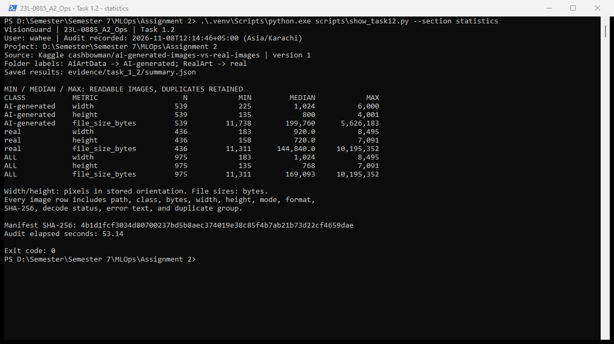
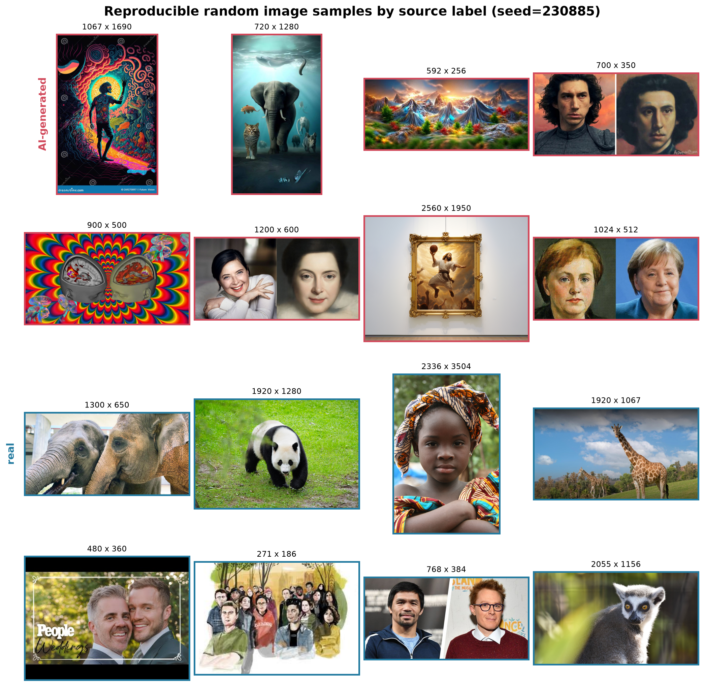
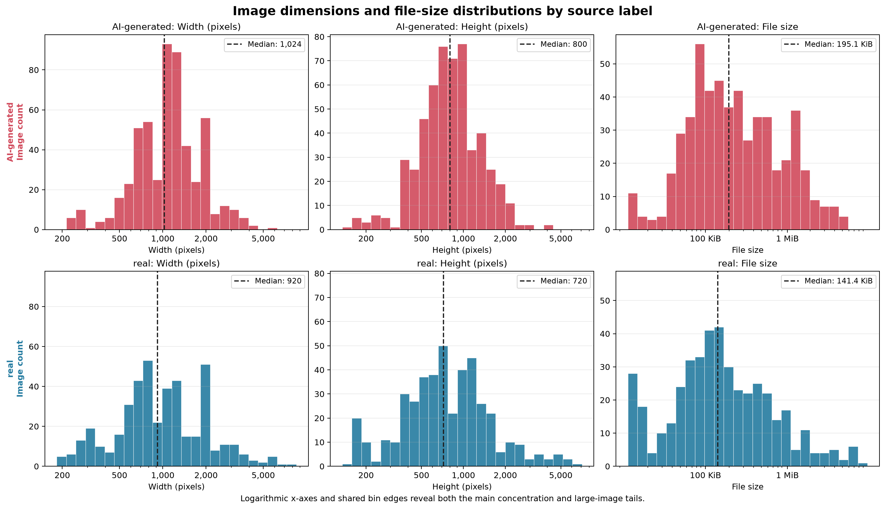

# VisionGuard MLOps Assignment 2

**Roll number:** 23L-0885  
**Project name:** 23L-0885_A2_Ops  
**Working directory:** `D:\Semester\Semester 7\MLOps\Assignment 2`  
**Scope of this draft:** Tasks 1.1, 1.2, and 1.3. Task 1.4 has not been completed.  
**AI assistance disclosure:** OpenAI Codex assisted with environment setup, dataset download, audit and EDA scripts, verification, evidence capture, and this report. Review and understand the commands, figures, and results before submitting.

## Task 1: Data Understanding and Versioning

### 1.1 Environment

#### Objective and approach

Create an isolated Python environment, install TensorFlow and supporting libraries, record exact versions, and check whether TensorFlow detects a GPU. The environment is stored in `.venv` inside the assignment directory. It excludes global site-packages so this project's dependencies are separate from other Python projects.

The existing Python 3.12.14 interpreter bundled with the local Codex runtime was used to create the environment because `python` and `py` were not available on the terminal PATH. This environment therefore depends on that base interpreter remaining installed. The `.venv` directory should not be committed or copied between computers; recreate it using Python 3.12 and the saved requirements instead.

#### Commands and their purpose

Commands were run in PowerShell from the assignment directory:

```powershell
Set-Location 'D:\Semester\Semester 7\MLOps\Assignment 2'
& 'C:\Users\wahee\.cache\codex-runtimes\codex-primary-runtime\dependencies\python\python.exe' -m venv .venv
.\.venv\Scripts\python.exe -m pip install tensorflow pandas matplotlib seaborn pillow scikit-learn
.\.venv\Scripts\python.exe scripts\check_environment.py --section versions
.\.venv\Scripts\python.exe scripts\check_environment.py --section gpu
.\.venv\Scripts\python.exe -m pip freeze --all | Set-Content -Encoding utf8 requirements.txt
```

- `Set-Location` selects the required project folder.
- `-m venv .venv` creates the isolated environment without enabling access to global site-packages.
- Calling `.venv\Scripts\python.exe` directly selects the project interpreter without requiring an activation script or a system PATH change.
- `-m pip install` installs packages into that interpreter's environment.
- `check_environment.py` records the project name, user, timestamp in Asia/Karachi, interpreter location, versions, isolation setting, dependency consistency, and TensorFlow devices. It also verifies a small matrix multiplication.
- `pip freeze --all` records every installed distribution, including packaging tools and transitive dependencies, in `requirements.txt`.

TensorFlow/Keras provides model-building support. Pillow reads image dimensions, colour modes, and image formats for the upcoming audit. pandas and NumPy support tabular and numerical analysis; Matplotlib and seaborn support EDA figures. scikit-learn supports later stratified splitting and evaluation. SHA-256 hashing is available through Python's built-in `hashlib`, so it needs no extra installation. DVC and later application/tracking tools will be added when their tasks are implemented.

#### Recorded versions and verification

Verification was performed on **8 November 2026 (Asia/Karachi)**.

| Component | Recorded version |
|---|---|
| Python | 3.12.14 |
| pip | 25.0.1 |
| TensorFlow | 2.21.0 |
| Keras | 3.15.1 |
| NumPy | 2.5.4 |
| pandas | 3.1.1 |
| Matplotlib | 3.11.2 |
| seaborn | 0.13.2 |
| Pillow | 13.0.0 |
| scikit-learn | 1.9.1 |

The original Task 1.1 dependency snapshot is in [Task 1.1 requirements](evidence/task_1_1/requirements.txt). The current [requirements.txt](requirements.txt) additionally includes the Kaggle download client installed for Task 1.2. Plain-text outputs are saved in [versions.txt](evidence/task_1_1/versions.txt) and [gpu.txt](evidence/task_1_1/gpu.txt). The screenshots show separate executions of the same verification script, so their timestamps can differ from those text logs.



**Figure 1.1a.** The terminal identifies project `23L-0885_A2_Ops`, user `wahee`, the date/time, and the assignment folder. The Python executable is inside `.venv`, `include-system-site-packages` is `false`, and `pip check` reports no broken requirements. The command exits successfully with code 0.



**Figure 1.1b.** TensorFlow detects one CPU device and zero GPU devices, reports that it was not built with CUDA, and successfully computes `[[1, 2]] x [[3], [4]] = [[11.0]]` on the CPU. The separate NVIDIA check identifies an NVIDIA GeForce RTX 4060 with 8,188 MiB reported memory and driver version 591.86. This establishes that TensorFlow works, but GPU acceleration is unavailable in this native-Windows environment.

**Result:** The isolated environment, exact-version record, dependency check, TensorFlow computation check, and GPU-detection check satisfy the implementation requirements of Task 1.1. No model training was performed.

#### GPU interpretation

The NVIDIA hardware inventory and TensorFlow's device list answer different questions. `nvidia-smi` checks whether the NVIDIA driver can see the physical GPU, whereas `tf.config.list_physical_devices('GPU')` checks which GPUs this TensorFlow installation can use.

Modern native-Windows TensorFlow packages do not support CUDA GPU execution; TensorFlow 2.10 was the last release with native-Windows CUDA support. An empty TensorFlow GPU list in this environment does not mean the computer has no GPU. For later GPU training, use a separately configured WSL2/Linux environment or a suitable GPU notebook environment. No GPU training or WSL2 setup is claimed in this task.

Source: [TensorFlow official installation guide](https://www.tensorflow.org/install/pip#windows-native).

#### Problems encountered

The standard `python` command was not available on PATH, so the existing interpreter was invoked using its absolute path. The initial package download was blocked by the execution sandbox's network restrictions; the installation was retried with network access and kept within the project environment. No global Python installation or system PATH modification was needed.

#### Reproduce the check

On this machine:

```powershell
.\.venv\Scripts\python.exe scripts\check_environment.py
```

On another Windows computer with Python 3.12 installed:

```powershell
py -3.12 -m venv .venv
.\.venv\Scripts\python.exe -m pip install -r requirements.txt
.\.venv\Scripts\python.exe scripts\check_environment.py
```

The requirements capture this Windows environment. A Linux/WSL2 GPU environment must be resolved and verified separately; this snapshot is not a claim of identical cross-platform packages or GPU behaviour.

### 1.2 Dataset audit

#### Objective and dataset source

Audit every image before cleaning or training: record its class, file size, dimensions, colour mode, actual image format, and SHA-256 hash; identify unreadable files and exact duplicates.

The assignment's [AI Generated Images vs Real Images dataset by cashbowman](https://www.kaggle.com/datasets/cashbowman/ai-generated-images-vs-real-images) was downloaded using the official `kagglehub` client. The downloaded and audited release is **version 1**, with **975 files** totalling **503,783,378 bytes** of uncompressed image data. The audit completed on **8 November 2026 at 12:14:46 +05:00 (Asia/Karachi)**.

Dataset location, relative to this project:

```text
data/kaggle_cache/datasets/cashbowman/ai-generated-images-vs-real-images/versions/1/
├── AiArtData/AiArtData/    -> AI-generated
└── RealArt/RealArt/        -> real
```

The folder names supply the labels; the script does not infer labels from image appearance or filenames. These are source-dataset labels, not independently verified claims about image provenance. The downloaded files were left unchanged. `data/` is Git-ignored pending the separate DVC task.

#### Implementation and commands

The custom [audit_dataset.py](scripts/audit_dataset.py) script recursively walks the dataset in deterministic path order. For each file it:

1. Assigns a class using the explicit ancestor-folder mapping above.
2. Records the file size in bytes and hashes the complete file in 1 MiB chunks with Python's `hashlib.sha256`.
3. Reads width, height, colour mode, format, and frame count with Pillow. Format comes from the image contents, not merely the filename extension.
4. Calls `verify()`, reopens the image, and calls `load()` on each frame to check pixel decoding as well as structural validity. It records exceptions without silently discarding problematic files.
5. Groups identical SHA-256 hashes, flags any groups spanning different classes, and writes the detailed CSV and summary evidence.

Recognized image extensions that cannot be decoded are marked `corrupt_or_unreadable`; unidentified files with other extensions are separately listed as non-images. Valid images are still recognized when their extension is missing or incorrect. File-access errors and Pillow's oversized-image safety failures are counted separately from corruption. No such exceptions or exclusions occurred in this run. A single worker was used for predictable resource use during full decoding.

Install the download client, then use the pinned download helper to reproduce dataset acquisition:

```powershell
.\.venv\Scripts\python.exe -m pip install kagglehub
.\.venv\Scripts\python.exe scripts\download_dataset.py
```

The initial download requested the dataset's current release, and Kaggle returned version 1. [download_dataset.py](scripts/download_dataset.py) pins that version for subsequent downloads. `kagglehub` version **1.0.3** and its dependencies are recorded in the updated requirements file.

Run the audit from the assignment directory:

```powershell
.\.venv\Scripts\python.exe scripts/audit_dataset.py --data-root data/kaggle_cache/datasets/cashbowman/ai-generated-images-vs-real-images/versions/1 --class-folder AiArtData=AI-generated --class-folder RealArt=real --workers 1
```

`--data-root` selects only the extracted dataset, excluding the cache's archive and metadata. Each `--class-folder` argument defines a folder-to-label mapping. `--workers 1` processes one file at a time. By default, results are saved outside the dataset at `evidence/task_1_2/`. The measured audit duration was **53.14 seconds**.

#### Counts per class and unreadable files

| Class | Image files | Share | Readable | Corrupt/unreadable | File-access errors | Safety-limit failures |
|---|---:|---:|---:|---:|---:|---:|
| AI-generated | 539 | 55.28% | 539 | 0 | 0 | 0 |
| real | 436 | 44.72% | 436 | 0 | 0 | 0 |
| **Total** | **975** | **100%** | **975** | **0** | **0** | **0** |

There were **0 non-image files** and **0 unmapped image labels**. These counts describe the original downloaded data, including duplicates. All files passed Pillow's structural and decoding checks; this does not establish that their labels or visual contents are correct.

The class balance is moderately uneven: there are 103 more AI-generated images than real images. A future split should preserve the class proportions and prevent duplicate leakage; no split has been made in Task 1.2.

#### Width, height, and file-size statistics

Statistics below use **all readable images, with duplicates retained**. Width and height are in pixels in the stored orientation, without EXIF rotation or resizing. File sizes are in **bytes**, not KB or KiB.

| Class | Measurement | Minimum | Median | Maximum |
|---|---|---:|---:|---:|
| AI-generated | Width (px) | 225 | 1,024 | 6,000 |
| AI-generated | Height (px) | 135 | 800 | 4,001 |
| AI-generated | File size (bytes) | 11,738 | 199,760 | 5,626,183 |
| real | Width (px) | 183 | 920 | 8,495 |
| real | Height (px) | 158 | 720 | 7,091 |
| real | File size (bytes) | 11,311 | 144,840 | 10,195,352 |
| **All images** | Width (px) | 183 | 1,024 | 8,495 |
| **All images** | Height (px) | 135 | 768 | 7,091 |
| **All images** | File size (bytes) | 11,311 | 169,093 | 10,195,352 |

The real class has lower median dimensions and file size, but larger maxima. Image dimensions and storage sizes vary substantially, so later training will require a consistent resizing strategy. Maximum width and maximum height are separate column statistics and need not belong to the same image.

#### Image formats and colour modes

| Class | JPEG | PNG | RGB | RGBA | Grayscale (`L`) | Palette (`P`) |
|---|---:|---:|---:|---:|---:|---:|
| AI-generated | 429 | 110 | 489 | 35 | 1 | 14 |
| real | 403 | 33 | 407 | 14 | 6 | 9 |
| **Total** | **832** | **143** | **896** | **49** | **7** | **23** |

The JPEG/PNG columns form one distribution, and the colour-mode columns form another; they should not be added together. The audit preserves original modes. A later input pipeline should deliberately handle grayscale, palette, and alpha-channel images before forming uniform model inputs.

#### Exact duplicates

| Measure | Result |
|---|---:|
| Duplicate groups | 1 |
| Files in duplicate groups | 2 |
| Extra copies beyond one per group | 1 |
| Cross-class duplicate groups | 0 |
| Distinct file hashes | 974 |

The duplicate pair is entirely within the AI-generated class:

- `AiArtData/AiArtData/image33.jpg`
- `AiArtData/AiArtData/image34.jpg`

Both files contain **163,866 bytes** and share SHA-256:

```text
f3268a4fc0477b2f3d9728f118afe32bf5196c3b476def53e34229672f77dc97
```

Their bytes were also compared directly and matched. Thus, “one extra duplicate” means one redundant copy, while “two files in a duplicate group” counts both the original and the extra copy. No files were deleted. Before splitting for training, keep only one copy or keep both in the same partition. SHA-256 identifies exact file duplicates; resized, recompressed, or visually similar images can have different hashes and are outside this exact-duplicate check.

#### Evidence



**Figure 1.2a.** The terminal displays the saved audit summary for all 975 images, including class counts, zero unreadable files, and the one exact-duplicate group. The project name, username, audit timestamp, source release, manifest hash, and working directory identify the run.



**Figure 1.2b.** The terminal displays all nine minimum/median/maximum rows for each class and the combined dataset. Units and inclusion of duplicates are stated explicitly. These screenshots display saved audit results through `show_task12.py`; they do not claim that a new audit was performed at screenshot time.

| Evidence file | Contents |
|---|---|
| [image_audit.csv](evidence/task_1_2/image_audit.csv) | One row for each of the 975 images, including every required metadata field and SHA-256 |
| [class_counts.csv](evidence/task_1_2/class_counts.csv) | Per-class and overall counts, decoding failures, and duplicate counts |
| [numeric_summary.csv](evidence/task_1_2/numeric_summary.csv) | Minimum, median, and maximum width, height, and file size |
| [unreadable_files.csv](evidence/task_1_2/unreadable_files.csv) | Header-only file: no unreadable images or other read failures were found |
| [exact_duplicates.csv](evidence/task_1_2/exact_duplicates.csv) | The two files in the duplicate group, with paths and hashes |
| [non_image_files.csv](evidence/task_1_2/non_image_files.csv) | Header-only file: no non-image files were found |
| [format_mode_counts.csv](evidence/task_1_2/format_mode_counts.csv) | Format and colour-mode frequencies |
| [summary.json](evidence/task_1_2/summary.json) | Machine-readable summary, source path, mapping, timestamp, and manifest hash |
| [audit_run.txt](evidence/task_1_2/audit_run.txt) | Output from the full audit execution |
| [script_tests.txt](evidence/task_1_2/script_tests.txt) | Five controlled audit-script tests, all passing |
| [validation.txt](evidence/task_1_2/validation.txt) | Independent statistics, file coverage, and duplicate-byte verification |

The manifest SHA-256 in `summary.json` hashes the sorted relative-path/file-hash listing. It is a reproducibility fingerprint, not a substitute for DVC versioning.

#### Validation and problems encountered

Five controlled tests verified content-based format detection, SHA-256 correctness, corrupt versus non-image handling, truncated pixel-data detection, duplicate groups across labels, summary statistics, and extensionless/unmapped images. These fixtures were temporary and were not added to the real dataset.

After the full audit, an independent pandas calculation matched every one of the nine numerical summary rows. The audit paths exactly matched all files on disk, and the duplicate pair passed a direct byte comparison. The updated environment also passed `pip check`.

Kaggle's direct HTTP download endpoints returned 404 in this execution environment. Switching to the official `kagglehub` client successfully downloaded the specified dataset; no alternative dataset or sample subset was substituted.

**Result:** Task 1.2 is complete. All required image metadata, class counts, minimum/median/maximum statistics, unreadable-file counts, exact-duplicate evidence, and explanatory report material are recorded. The original dataset remains unchanged; visual EDA and DVC are still separate upcoming tasks.

### 1.3 Visual EDA

#### Method

The custom [visual_eda.py](scripts/visual_eda.py) script reads the verified Task 1.2 audit table rather than rescanning or changing the dataset. It produces a reproducible sample grid and six histograms: width, height, and file size for each source class.

The grid contains eight images per class selected with random seed **230885** from paths sorted deterministically within each class. Exact duplicate copies are excluded from the sampling pool so the grid does not display the same bytes twice. The selected paths, dimensions, sizes, and SHA-256 hashes are recorded in [sample_manifest.csv](evidence/task_1_3/sample_manifest.csv), making the displayed sample reproducible rather than hand-picked.

The histogram panels use all **975 readable images**, including the duplicate pair, so their population matches the original audited dataset. Both classes use the same 25 logarithmically spaced bin edges for each measurement; logarithmic x-axes keep the main concentration and the long upper tails visible. Dashed lines show class medians, and y-axes report image counts.

Run the EDA from the assignment directory:

```powershell
.\.venv\Scripts\python.exe scripts\visual_eda.py
```

This command saves the figures and supporting files under `evidence/task_1_3/` without modifying source images.

#### Sample images by class



**Figure 1.3a. Sample images by source label.** The fixed-seed sample shows substantial variation within both classes: portraits, animals, landscapes, composite images, artwork, different aspect ratios, and resolutions all appear. The classes also overlap visually—both contain photographic and artistic content, faces, animals, text, and watermarks—so visible style alone is not a reliable label rule and may create shortcut-learning risks that should be checked during later error analysis.

#### Width, height, and file-size distributions



**Figure 1.3b. Per-class dimension and file-size histograms.** AI-generated images have higher medians for width (**1,024 vs 920 px**), height (**800 vs 720 px**), and file size (**195.1 vs 141.4 KiB**), but the distributions overlap strongly; these metadata values therefore cannot by themselves distinguish the classes. The real class has the longer dimension tails—26 real images exceed 3,000 px in width and 27 exceed 2,500 px in height, compared with 11 and 6 AI-generated images—while files over 2 MiB occur at similar rates (22/436 real, **5.0%**, and 25/539 AI-generated, **4.6%**).

The middle 50% of AI-generated widths spans **768–1,449.5 px**, compared with **626–1,600 px** for real images. For height, the corresponding intervals are **588–1,052 px** and **465.75–1,184.5 px**. This spread supports resizing to a fixed model input later, but preprocessing must be applied consistently and should avoid turning source-resolution differences into an unintended class cue.

#### Evidence and reproducibility

| Evidence file | Contents |
|---|---|
| [sample_grid.png](evidence/task_1_3/sample_grid.png) | Eight fixed-seed, unique-hash samples from each class, with original stored dimensions |
| [histograms.png](evidence/task_1_3/histograms.png) | Width, height, and file-size histograms for each class with shared log bins and median markers |
| [sample_manifest.csv](evidence/task_1_3/sample_manifest.csv) | Exact paths, labels, dimensions, sizes, and hashes for the 16 displayed samples |
| [eda_summary.json](evidence/task_1_3/eda_summary.json) | Counts, quartiles, medians, tail counts, seed, and samples-per-class |
| [eda_run.txt](evidence/task_1_3/eda_run.txt) | Successful EDA command output |
| [validation.txt](evidence/task_1_3/validation.txt) | Independent checks of samples, statistics, figures, and source-file preservation |

The figures were inspected at their exported resolution after generation. The sample grid is **2,090 × 2,037 pixels**, and the histogram figure is **2,720 × 1,569 pixels**, which keeps labels and individual images readable when placed in the final report.

**Result:** Task 1.3 is complete. The report includes a reproducible per-class sample grid, per-class histograms for all three required measurements, figure captions, and two-to-three-sentence interpretations for each figure. No training split, augmentation, or model preprocessing was performed as part of this exploratory task.
