# VisionGuard MLOps Assignment 2

**Roll number:** 23L-0885  
**Project name:** 23L-0885_A2_Ops  
**Working directory:** `D:\Semester\Semester 7\MLOps\Assignment 2`  
**Scope of this draft:** Task 1 (sub-tasks 1.1-1.4) is complete.  
**AI assistance disclosure:** OpenAI Codex assisted with environment setup, dataset download, audit and EDA scripts, Git/DVC workflows, verification, evidence capture, and this report. Review and understand the commands, figures, and results before submitting.

## Task 1: Data Understanding and Versioning

### 1.1 Environment

#### Objective and approach

Create an isolated Python environment, install TensorFlow and supporting libraries, record exact versions, and check whether TensorFlow detects a GPU. The environment is stored in `.venv` inside the assignment directory. It excludes global site-packages so this project's dependencies are separate from other Python projects.

The existing Python 3.12.14 interpreter bundled with the local Codex runtime was used to create the environment because `python` and `py` were not available on the terminal PATH. This environment therefore depends on that base interpreter remaining installed. The `.venv` directory should not be committed or copied between computers; recreate it using Python 3.12 and the saved requirements instead.

#### Commands and their purpose

Commands were run in PowerShell from the assignment directory:

```powershell
Set-Location 'D:\Semester\Semester 7\MLOps\Assignment 2'
& 'C:\Users\wahee\.cache\codex-runtimes\codex-primary-runtime\dependencies\python\python.exe' -m venv .venv
.\.venv\Scripts\python.exe -m pip install tensorflow pandas matplotlib seaborn pillow scikit-learn
.\.venv\Scripts\python.exe scripts\check_environment.py --section versions
.\.venv\Scripts\python.exe scripts\check_environment.py --section gpu
.\.venv\Scripts\python.exe -m pip freeze --all | Set-Content -Encoding utf8 requirements.txt
```

- `Set-Location` selects the required project folder.
- `-m venv .venv` creates the isolated environment without enabling access to global site-packages.
- Calling `.venv\Scripts\python.exe` directly selects the project interpreter without requiring an activation script or a system PATH change.
- `-m pip install` installs packages into that interpreter's environment.
- `check_environment.py` records the project name, user, timestamp in Asia/Karachi, interpreter location, versions, isolation setting, dependency consistency, and TensorFlow devices. It also verifies a small matrix multiplication.
- `pip freeze --all` records every installed distribution, including packaging tools and transitive dependencies, in `requirements.txt`.

TensorFlow/Keras provides model-building support. Pillow reads image dimensions, colour modes, and image formats for the upcoming audit. pandas and NumPy support tabular and numerical analysis; Matplotlib and seaborn support EDA figures. scikit-learn supports later stratified splitting and evaluation. SHA-256 hashing is available through Python's built-in `hashlib`, so it needs no extra installation. DVC and later application/tracking tools will be added when their tasks are implemented.

#### Recorded versions and verification

Verification was performed on **8 November 2026 (Asia/Karachi)**.

| Component | Recorded version |
|---|---|
| Python | 3.12.14 |
| pip | 25.0.1 |
| TensorFlow | 2.21.0 |
| Keras | 3.15.1 |
| NumPy | 2.5.4 |
| pandas | 3.1.1 |
| Matplotlib | 3.11.2 |
| seaborn | 0.13.2 |
| Pillow | 13.0.0 |
| scikit-learn | 1.9.1 |

The original Task 1.1 dependency snapshot is in [Task 1.1 requirements](evidence/task_1_1/requirements.txt). The current [requirements.txt](requirements.txt) additionally includes the Kaggle download client installed for Task 1.2. Plain-text outputs are saved in [versions.txt](evidence/task_1_1/versions.txt) and [gpu.txt](evidence/task_1_1/gpu.txt). The screenshots show separate executions of the same verification script, so their timestamps can differ from those text logs.


**Figure 1.1a.** The terminal identifies project `23L-0885_A2_Ops`, user `wahee`, the date/time, and the assignment folder. The Python executable is inside `.venv`, `include-system-site-packages` is `false`, and `pip check` reports no broken requirements. The command exits successfully with code 0.


**Figure 1.1b.** TensorFlow detects one CPU device and zero GPU devices, reports that it was not built with CUDA, and successfully computes `[[1, 2]] x [[3], [4]] = [[11.0]]` on the CPU. The separate NVIDIA check identifies an NVIDIA GeForce RTX 4060 with 8,188 MiB reported memory and driver version 591.86. This establishes that TensorFlow works, but GPU acceleration is unavailable in this native-Windows environment.

**Result:** The isolated environment, exact-version record, dependency check, TensorFlow computation check, and GPU-detection check satisfy the implementation requirements of Task 1.1. No model training was performed.

#### GPU interpretation

The NVIDIA hardware inventory and TensorFlow's device list answer different questions. `nvidia-smi` checks whether the NVIDIA driver can see the physical GPU, whereas `tf.config.list_physical_devices('GPU')` checks which GPUs this TensorFlow installation can use.

Modern native-Windows TensorFlow packages do not support CUDA GPU execution; TensorFlow 2.10 was the last release with native-Windows CUDA support. An empty TensorFlow GPU list in this environment does not mean the computer has no GPU. For later GPU training, use a separately configured WSL2/Linux environment or a suitable GPU notebook environment. No GPU training or WSL2 setup is claimed in this task.

Source: [TensorFlow official installation guide](https://www.tensorflow.org/install/pip#windows-native).

#### Problems encountered

The standard `python` command was not available on PATH, so the existing interpreter was invoked using its absolute path. The initial package download was blocked by the execution sandbox's network restrictions; the installation was retried with network access and kept within the project environment. No global Python installation or system PATH modification was needed.

#### Reproduce the check

On this machine:

```powershell
.\.venv\Scripts\python.exe scripts\check_environment.py
```

On another Windows computer with Python 3.12 installed:

```powershell
py -3.12 -m venv .venv
.\.venv\Scripts\python.exe -m pip install -r requirements.txt
.\.venv\Scripts\python.exe scripts\check_environment.py
```

The requirements capture this Windows environment. A Linux/WSL2 GPU environment must be resolved and verified separately; this snapshot is not a claim of identical cross-platform packages or GPU behaviour.

### 1.2 Dataset audit

#### Objective and dataset source

Audit every image before cleaning or training: record its class, file size, dimensions, colour mode, actual image format, and SHA-256 hash; identify unreadable files and exact duplicates.

The assignment's [AI Generated Images vs Real Images dataset by cashbowman](https://www.kaggle.com/datasets/cashbowman/ai-generated-images-vs-real-images) was downloaded using the official `kagglehub` client. The downloaded and audited release is **version 1**, with **975 files** totalling **503,783,378 bytes** of uncompressed image data. The audit completed on **8 November 2026 at 12:14:46 +05:00 (Asia/Karachi)**.

Dataset location, relative to this project:

```text
data/kaggle_cache/datasets/cashbowman/ai-generated-images-vs-real-images/versions/1/
├── AiArtData/AiArtData/    -> AI-generated
└── RealArt/RealArt/        -> real
```

The folder names supply the labels; the script does not infer labels from image appearance or filenames. These are source-dataset labels, not independently verified claims about image provenance. The downloaded files were left unchanged. `data/` is Git-ignored pending the separate DVC task.

#### Implementation and commands

The custom [audit_dataset.py](scripts/audit_dataset.py) script recursively walks the dataset in deterministic path order. For each file it:

1. Assigns a class using the explicit ancestor-folder mapping above.
2. Records the file size in bytes and hashes the complete file in 1 MiB chunks with Python's `hashlib.sha256`.
3. Reads width, height, colour mode, format, and frame count with Pillow. Format comes from the image contents, not merely the filename extension.
4. Calls `verify()`, reopens the image, and calls `load()` on each frame to check pixel decoding as well as structural validity. It records exceptions without silently discarding problematic files.
5. Groups identical SHA-256 hashes, flags any groups spanning different classes, and writes the detailed CSV and summary evidence.

Recognized image extensions that cannot be decoded are marked `corrupt_or_unreadable`; unidentified files with other extensions are separately listed as non-images. Valid images are still recognized when their extension is missing or incorrect. File-access errors and Pillow's oversized-image safety failures are counted separately from corruption. No such exceptions or exclusions occurred in this run. A single worker was used for predictable resource use during full decoding.

Install the download client, then use the pinned download helper to reproduce dataset acquisition:

```powershell
.\.venv\Scripts\python.exe -m pip install kagglehub
.\.venv\Scripts\python.exe scripts\download_dataset.py
```

The initial download requested the dataset's current release, and Kaggle returned version 1. [download_dataset.py](scripts/download_dataset.py) pins that version for subsequent downloads. `kagglehub` version **1.0.3** and its dependencies are recorded in the updated requirements file.

Run the audit from the assignment directory:

```powershell
.\.venv\Scripts\python.exe scripts/audit_dataset.py --data-root data/kaggle_cache/datasets/cashbowman/ai-generated-images-vs-real-images/versions/1 --class-folder AiArtData=AI-generated --class-folder RealArt=real --workers 1
```

`--data-root` selects only the extracted dataset, excluding the cache's archive and metadata. Each `--class-folder` argument defines a folder-to-label mapping. `--workers 1` processes one file at a time. By default, results are saved outside the dataset at `evidence/task_1_2/`. The measured audit duration was **53.14 seconds**.

#### Counts per class and unreadable files

| Class | Image files | Share | Readable | Corrupt/unreadable | File-access errors | Safety-limit failures |
|---|---:|---:|---:|---:|---:|---:|
| AI-generated | 539 | 55.28% | 539 | 0 | 0 | 0 |
| real | 436 | 44.72% | 436 | 0 | 0 | 0 |
| **Total** | **975** | **100%** | **975** | **0** | **0** | **0** |

There were **0 non-image files** and **0 unmapped image labels**. These counts describe the original downloaded data, including duplicates. All files passed Pillow's structural and decoding checks; this does not establish that their labels or visual contents are correct.

The class balance is moderately uneven: there are 103 more AI-generated images than real images. A future split should preserve the class proportions and prevent duplicate leakage; no split has been made in Task 1.2.

#### Width, height, and file-size statistics

Statistics below use **all readable images, with duplicates retained**. Width and height are in pixels in the stored orientation, without EXIF rotation or resizing. File sizes are in **bytes**, not KB or KiB.

| Class | Measurement | Minimum | Median | Maximum |
|---|---|---:|---:|---:|
| AI-generated | Width (px) | 225 | 1,024 | 6,000 |
| AI-generated | Height (px) | 135 | 800 | 4,001 |
| AI-generated | File size (bytes) | 11,738 | 199,760 | 5,626,183 |
| real | Width (px) | 183 | 920 | 8,495 |
| real | Height (px) | 158 | 720 | 7,091 |
| real | File size (bytes) | 11,311 | 144,840 | 10,195,352 |
| **All images** | Width (px) | 183 | 1,024 | 8,495 |
| **All images** | Height (px) | 135 | 768 | 7,091 |
| **All images** | File size (bytes) | 11,311 | 169,093 | 10,195,352 |

The real class has lower median dimensions and file size, but larger maxima. Image dimensions and storage sizes vary substantially, so later training will require a consistent resizing strategy. Maximum width and maximum height are separate column statistics and need not belong to the same image.

#### Image formats and colour modes

| Class | JPEG | PNG | RGB | RGBA | Grayscale (`L`) | Palette (`P`) |
|---|---:|---:|---:|---:|---:|---:|
| AI-generated | 429 | 110 | 489 | 35 | 1 | 14 |
| real | 403 | 33 | 407 | 14 | 6 | 9 |
| **Total** | **832** | **143** | **896** | **49** | **7** | **23** |

The JPEG/PNG columns form one distribution, and the colour-mode columns form another; they should not be added together. The audit preserves original modes. A later input pipeline should deliberately handle grayscale, palette, and alpha-channel images before forming uniform model inputs.

#### Exact duplicates

| Measure | Result |
|---|---:|
| Duplicate groups | 1 |
| Files in duplicate groups | 2 |
| Extra copies beyond one per group | 1 |
| Cross-class duplicate groups | 0 |
| Distinct file hashes | 974 |

The duplicate pair is entirely within the AI-generated class:

- `AiArtData/AiArtData/image33.jpg`
- `AiArtData/AiArtData/image34.jpg`

Both files contain **163,866 bytes** and share SHA-256:

```text
f3268a4fc0477b2f3d9728f118afe32bf5196c3b476def53e34229672f77dc97
```

Their bytes were also compared directly and matched. Thus, “one extra duplicate” means one redundant copy, while “two files in a duplicate group” counts both the original and the extra copy. No files were deleted. Before splitting for training, keep only one copy or keep both in the same partition. SHA-256 identifies exact file duplicates; resized, recompressed, or visually similar images can have different hashes and are outside this exact-duplicate check.

#### Evidence


**Figure 1.2a.** The terminal displays the saved audit summary for all 975 images, including class counts, zero unreadable files, and the one exact-duplicate group. The project name, username, audit timestamp, source release, manifest hash, and working directory identify the run.


**Figure 1.2b.** The terminal displays all nine minimum/median/maximum rows for each class and the combined dataset. Units and inclusion of duplicates are stated explicitly. These screenshots display saved audit results through `show_task12.py`; they do not claim that a new audit was performed at screenshot time.

| Evidence file | Contents |
|---|---|
| [image_audit.csv](evidence/task_1_2/image_audit.csv) | One row for each of the 975 images, including every required metadata field and SHA-256 |
| [class_counts.csv](evidence/task_1_2/class_counts.csv) | Per-class and overall counts, decoding failures, and duplicate counts |
| [numeric_summary.csv](evidence/task_1_2/numeric_summary.csv) | Minimum, median, and maximum width, height, and file size |
| [unreadable_files.csv](evidence/task_1_2/unreadable_files.csv) | Header-only file: no unreadable images or other read failures were found |
| [exact_duplicates.csv](evidence/task_1_2/exact_duplicates.csv) | The two files in the duplicate group, with paths and hashes |
| [non_image_files.csv](evidence/task_1_2/non_image_files.csv) | Header-only file: no non-image files were found |
| [format_mode_counts.csv](evidence/task_1_2/format_mode_counts.csv) | Format and colour-mode frequencies |
| [summary.json](evidence/task_1_2/summary.json) | Machine-readable summary, source path, mapping, timestamp, and manifest hash |
| [audit_run.txt](evidence/task_1_2/audit_run.txt) | Output from the full audit execution |
| [script_tests.txt](evidence/task_1_2/script_tests.txt) | Five controlled audit-script tests, all passing |
| [validation.txt](evidence/task_1_2/validation.txt) | Independent statistics, file coverage, and duplicate-byte verification |

The manifest SHA-256 in `summary.json` hashes the sorted relative-path/file-hash listing. It is a reproducibility fingerprint, not a substitute for DVC versioning.

#### Validation and problems encountered

Five controlled tests verified content-based format detection, SHA-256 correctness, corrupt versus non-image handling, truncated pixel-data detection, duplicate groups across labels, summary statistics, and extensionless/unmapped images. These fixtures were temporary and were not added to the real dataset.

After the full audit, an independent pandas calculation matched every one of the nine numerical summary rows. The audit paths exactly matched all files on disk, and the duplicate pair passed a direct byte comparison. The updated environment also passed `pip check`.

Kaggle's direct HTTP download endpoints returned 404 in this execution environment. Switching to the official `kagglehub` client successfully downloaded the specified dataset; no alternative dataset or sample subset was substituted.

**Result:** Task 1.2 is complete. All required image metadata, class counts, minimum/median/maximum statistics, unreadable-file counts, exact-duplicate evidence, and explanatory report material are recorded. The original dataset remains unchanged; visual EDA and DVC are still separate upcoming tasks.

### 1.3 Visual EDA

#### Method

The custom [visual_eda.py](scripts/visual_eda.py) script reads the verified Task 1.2 audit table rather than rescanning or changing the dataset. It produces a reproducible sample grid and six histograms: width, height, and file size for each source class.

The grid contains eight images per class selected with random seed **230885** from paths sorted deterministically within each class. Exact duplicate copies are excluded from the sampling pool so the grid does not display the same bytes twice. The selected paths, dimensions, sizes, and SHA-256 hashes are recorded in [sample_manifest.csv](evidence/task_1_3/sample_manifest.csv), making the displayed sample reproducible rather than hand-picked.

The histogram panels use all **975 readable images**, including the duplicate pair, so their population matches the original audited dataset. Both classes use the same 25 logarithmically spaced bin edges for each measurement; logarithmic x-axes keep the main concentration and the long upper tails visible. Dashed lines show class medians, and y-axes report image counts.

Run the EDA from the assignment directory:

```powershell
.\.venv\Scripts\python.exe scripts\visual_eda.py
```

This command saves the figures and supporting files under `evidence/task_1_3/` without modifying source images.

#### Sample images by class


**Figure 1.3a. Sample images by source label.** The fixed-seed sample shows substantial variation within both classes: portraits, animals, landscapes, composite images, artwork, different aspect ratios, and resolutions all appear. The classes also overlap visually—both contain photographic and artistic content, faces, animals, text, and watermarks—so visible style alone is not a reliable label rule and may create shortcut-learning risks that should be checked during later error analysis.

#### Width, height, and file-size distributions


**Figure 1.3b. Per-class dimension and file-size histograms.** AI-generated images have higher medians for width (**1,024 vs 920 px**), height (**800 vs 720 px**), and file size (**195.1 vs 141.4 KiB**), but the distributions overlap strongly; these metadata values therefore cannot by themselves distinguish the classes. The real class has the longer dimension tails—26 real images exceed 3,000 px in width and 27 exceed 2,500 px in height, compared with 11 and 6 AI-generated images—while files over 2 MiB occur at similar rates (22/436 real, **5.0%**, and 25/539 AI-generated, **4.6%**).

The middle 50% of AI-generated widths spans **768–1,449.5 px**, compared with **626–1,600 px** for real images. For height, the corresponding intervals are **588–1,052 px** and **465.75–1,184.5 px**. This spread supports resizing to a fixed model input later, but preprocessing must be applied consistently and should avoid turning source-resolution differences into an unintended class cue.

#### Evidence and reproducibility

| Evidence file | Contents |
|---|---|
| [sample_grid.png](evidence/task_1_3/sample_grid.png) | Eight fixed-seed, unique-hash samples from each class, with original stored dimensions |
| [histograms.png](evidence/task_1_3/histograms.png) | Width, height, and file-size histograms for each class with shared log bins and median markers |
| [sample_manifest.csv](evidence/task_1_3/sample_manifest.csv) | Exact paths, labels, dimensions, sizes, and hashes for the 16 displayed samples |
| [eda_summary.json](evidence/task_1_3/eda_summary.json) | Counts, quartiles, medians, tail counts, seed, and samples-per-class |
| [eda_run.txt](evidence/task_1_3/eda_run.txt) | Successful EDA command output |
| [validation.txt](evidence/task_1_3/validation.txt) | Independent checks of samples, statistics, figures, and source-file preservation |

The figures were inspected at their exported resolution after generation. The sample grid is **2,090 × 2,037 pixels**, and the histogram figure is **2,720 × 1,569 pixels**, which keeps labels and individual images readable when placed in the final report.

**Result:** Task 1.3 is complete. The report includes a reproducible per-class sample grid, per-class histograms for all three required measurements, figure captions, and two-to-three-sentence interpretations for each figure. No training split, augmentation, or model preprocessing was performed as part of this exploratory task.

### 1.4 DVC (data version control)

#### Purpose and setup

Git and DVC were initialized in the existing `23L-0885_A2_Ops` project so the completed Task 1 work was preserved. The Git remote is the private [DagsHub repository](https://dagshub.com/waheedsarem/23L-0885_A2_Ops), and the DVC remote uses DagsHub's S3-compatible storage:

```powershell
git init -b main
git remote add origin https://dagshub.com/waheedsarem/23L-0885_A2_Ops.git
.\.venv\Scripts\dvc.exe init
.\.venv\Scripts\dvc.exe remote add -d origin s3://dvc
.\.venv\Scripts\dvc.exe remote modify origin endpointurl https://dagshub.com/waheedsarem/23L-0885_A2_Ops.s3
```

DVC **3.67.1** with `dvc-s3` **3.3.0** was installed in `.venv`. Only the endpoint is stored in tracked `.dvc/config`. The DagsHub access token is stored as the access key and secret key in `.dvc/config.local`, which DVC automatically lists in `.dvc/.gitignore`; the token is not present in Git, screenshots, or this report. DagsHub documents this `--local` credential pattern in its [DVC integration guide](https://dagshub.com/docs/integration_guide/dvc/).

#### Toy CSV: two data versions

The required toy exercise was performed in a new isolated repository at `evidence/task_1_4/toy_repo/`. Its generated Git/DVC internals and data remote are excluded from the main repository. Version 1 contained two rows:

```csv
id,value
1,alpha
2,beta
```

It was tracked with `dvc add data/toy.csv` and committed as `b3c76ce` (`Toy DVC: track CSV version 1`). A third row, `3,gamma`, was then added, the pointer was updated with `dvc add`, and version 2 was committed as `26335d6` (`Toy DVC: update CSV to version 2`). The `dvc-toy` branch containing both commits was pushed to DagsHub.

| Toy version | Git commit | Rows | File size | DVC MD5 |
|---|---|---:|---:|---|
| Version 1 | `b3c76ce` | 2 | 24 bytes | `6bd3bfa8c3a8f1c5177bbe9ae4463ad6` |
| Version 2 | `26335d6` | 3 | 32 bytes | `a63bbadcd07bbedd9b44379e7243c4bb` |

The older version was restored by checking out version 1's `.dvc` pointer and running `dvc checkout`. This produced the original two-row CSV. The current pointer was then restored from `dvc-toy`, and another `dvc checkout` returned the three-row version without storing either CSV directly in Git.

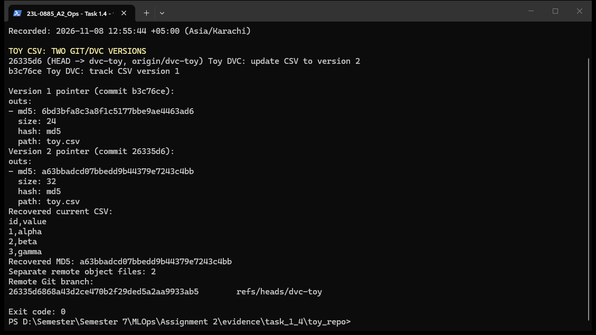

**Figure 1.4a. Toy Git/DVC history.** The terminal shows both toy commits on the remote-tracking `dvc-toy` branch and the different pointer hashes and sizes for versions 1 and 2. It also shows the recovered current CSV, matching MD5, two objects in the separate data remote, and the DagsHub branch hash.

#### Toy remote push, deletion, and recovery

A separate local folder was configured as the toy DVC remote, as explicitly permitted by the assignment:

```powershell
dvc remote add -d localstore ..\toy_remote
dvc push -r localstore
```

Both version objects were pushed. For a strong recovery test, the working CSV and its exact current object in `.dvc/cache` were both removed after confirming the separate remote object existed. Therefore, the subsequent `dvc pull -r localstore` could not reuse the working file or local cache; it fetched the object from the remote, rebuilt both, and restored MD5 `a63bbadcd07bbedd9b44379e7243c4bb`.

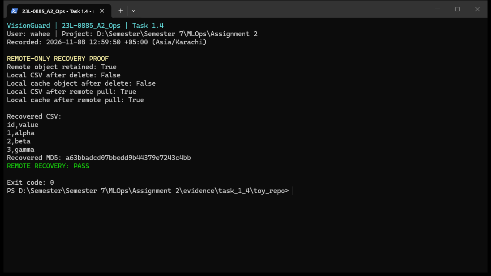

**Figure 1.4b. Remote-only recovery proof.** Before the pull, the separate remote object remains available while both the local CSV and its cache object report `False`. After the pull, both report `True`, the three expected rows are present, and the recovered MD5 matches version 2; the script reports `REMOTE RECOVERY: PASS`.

#### Applying DVC to the assignment dataset

A clean project-level copy of the exact audited Kaggle release was created at `dataset/raw/`. Before tracking, it was independently checked against the Task 1.2 source: both contained **975 files** and **503,783,378 bytes**. DVC then generated [dataset/raw.dvc](dataset/raw.dvc):

```yaml
outs:
- md5: b2cec67839f742df4653f66d4bcbbafb.dir
  size: 503783378
  nfiles: 975
  hash: md5
  path: raw
```

The pointer and DVC-generated ignore file were committed as `7f467a7` (`Track audited image dataset with DVC`). `dvc push -r origin` uploaded all **975 files** to DagsHub storage. `dvc status -c` subsequently reported `Cache and remote 'origin' are in sync`, while ordinary `dvc status` reported that data and pipelines were up to date. The `main` and `dvc-toy` branches were both pushed and their remote hashes were checked with `git ls-remote`.

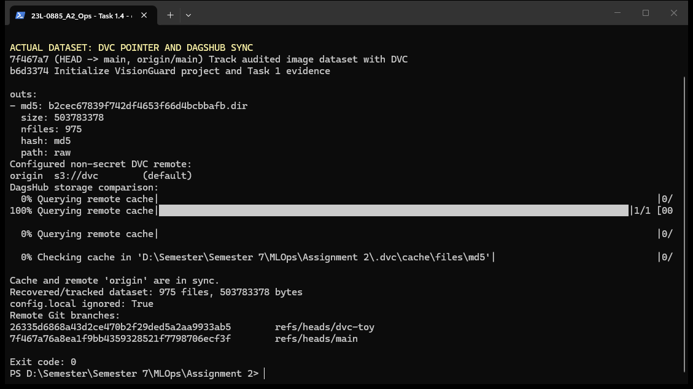

**Figure 1.4c. Dataset version and DagsHub synchronization.** The terminal shows the 975-file pointer, its directory hash and exact byte size, the non-secret `s3://dvc` remote, and confirmation that the cache and DagsHub remote are synchronized. It also proves `.dvc/config.local` is ignored and displays the remote hashes for `main` and `dvc-toy` without exposing credentials.

#### What the pointer file contains

`dataset/raw.dvc` is a small YAML metadata file. Its `.dir` MD5 identifies DVC's manifest for the directory state; `size` is the combined data size, `nfiles` records the number of files, and `path` tells DVC where to materialize the directory. For the single toy CSV, the pointer instead stores the file's MD5, size, hash type, and relative path.

The pointer does **not** contain image bytes or a downloadable copy of the dataset. Git versions this small pointer and the DVC configuration, while DVC stores content-addressed objects in its local cache and configured remote. Changing data changes the pointer hash, so a Git commit selects the matching data version and `dvc pull` retrieves it.

Large datasets do not belong directly in Git because Git retains every committed blob in repository history, making clones, fetches, and repository maintenance increasingly expensive even after files are later removed from the working tree. DVC keeps Git history small, transfers large objects only through data storage, deduplicates unchanged content by hash, and still links each code commit to a reproducible dataset version.

#### Problems encountered and verification

The execution sandbox used a different Windows account from the folder owner, so Git required the assignment directory to be marked as a safe repository. DVC also initially selected a shared cache under `C:\ProgramData`, which the sandbox could not write; `DVC_SITE_CACHE_DIR` redirected this operational cache into the project's ignored `.dvc/site-cache`. These are sandbox-specific execution details and do not change the repository or data version.

Because the DagsHub account was created through GitHub, it had no separate account password for Git Credential Manager. A DagsHub access token was used as the Git password and for DVC storage, following DagsHub's documented authentication method. A helper script, [configure_dagshub_auth.ps1](scripts/configure_dagshub_auth.ps1), accepts the token through a masked Windows credential dialog and writes it only to ignored local DVC configuration.

Verification completed successfully:

- The main repository has a clean DVC state and tracks `origin/main`.
- DagsHub's DVC remote contains all 975 dataset files and matches the local cache.
- The `dvc-toy` remote branch contains both toy pointer commits.
- Version 1 and version 2 produce different pointer hashes and correct contents.
- Remote-only toy recovery succeeds after deleting both the local CSV and current cache object.
- `git check-ignore .dvc/config.local` confirms credentials cannot be staged by the normal workflow.
- Tracked files contain no DVC access-key or secret-key settings.

**Result:** Task 1.4 is complete. The toy repository demonstrates initialization, two committed data versions, older-version restoration, remote push, local deletion, and remote pull. The complete audited image dataset is tracked by a small DVC pointer, stored in synchronized DagsHub storage, and linked to the Git history without placing its 503.8 MB of image bytes in Git.

---

# Task 2: Model Development with TensorFlow/Keras

## 2.1 Input pipeline

The audited data was split once with seed `230885` after excluding the one exact duplicate copy found in Task 1. The stratified split contains 681 training images, 146 validation images, and 147 test images. SHA-256 overlap checks between every pair of splits are zero. The label mapping is `real = 0` and `AI-generated = 1`.

The `tf.data` pipeline reads file paths from the saved CSV manifests, decodes each image to three RGB channels, converts pixels to floating point, and uses `tf.image.resize_with_pad` to produce `160 x 160` inputs. Padding preserves the original aspect ratio instead of stretching subjects. Images are batched in groups of 16 and prefetched with `AUTOTUNE`. Only the training pipeline shuffles and applies random horizontal flips, rotations, zooms, and contrast changes; validation and test images are deterministic and unaugmented.

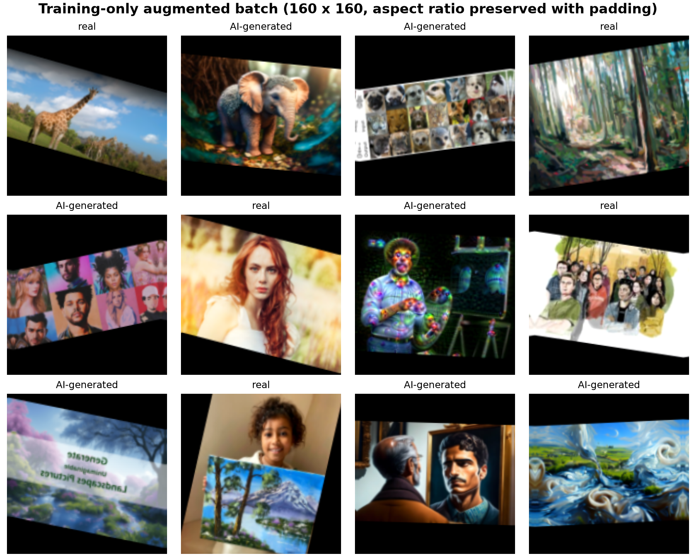

**Figure 2.1.** A training batch after augmentation. The black padded regions show where aspect ratio was preserved; geometric and contrast changes increase training diversity without contaminating validation or test measurements.

## 2.2 Baseline CNN

The baseline is a small CNN built from scratch. Each of three blocks uses a `3 x 3` convolution to learn local features, batch normalization to stabilize optimization, ReLU for non-linearity, and max pooling to reduce spatial resolution. Filter counts increase from 32 to 64 to 128 as spatial size decreases. Global average pooling reduces parameter count, a 64-unit dense layer combines the learned features, dropout (`0.40`) limits overfitting, and one sigmoid unit outputs the probability that an image is AI-generated.

Binary cross-entropy is appropriate for the two-class sigmoid output. Adam with learning rate `1e-3` provides adaptive optimization. Accuracy, precision, recall, and ROC-AUC were tracked because accuracy alone can hide the different costs of false positives and false negatives.

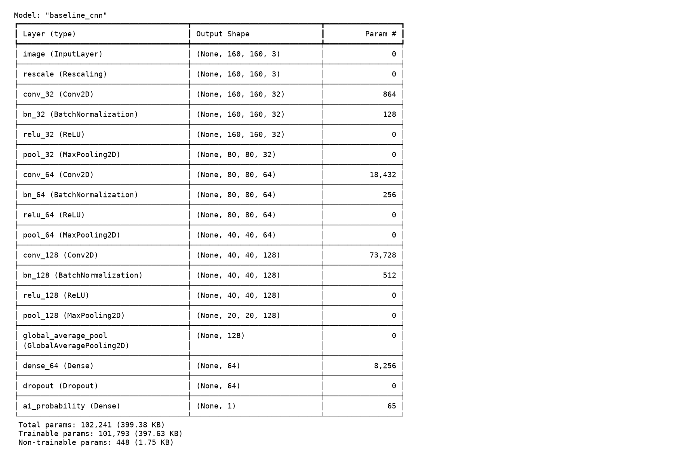

**Figure 2.2.** Baseline Keras model summary, including output shapes and parameter counts. The machine-readable per-layer table is in [`evidence/task_2/baseline_cnn_layers.csv`](evidence/task_2/baseline_cnn_layers.csv).

## 2.3 Transfer learning

MobileNetV2 with ImageNet weights was selected because it is a lightweight pretrained network suitable for a modest dataset and CPU execution. Inputs remain in RGB at `160 x 160`; `mobilenet_v2.preprocess_input` scales pixel values to the range expected by the pretrained weights. A global-average-pooling layer, dropout (`0.35`), and sigmoid classification head replace the original ImageNet classifier.

In stage 1, the entire MobileNetV2 base was frozen and only the new head was trained with Adam at `1e-3`. In stage 2, the final 20 base layers were considered for fine-tuning; BatchNormalization layers remained frozen, leaving 13 trainable base layers. Fine-tuning used the much smaller learning rate `1e-5` to avoid destroying useful pretrained features. The base was called with `training=False` so BatchNormalization statistics remained in inference mode.

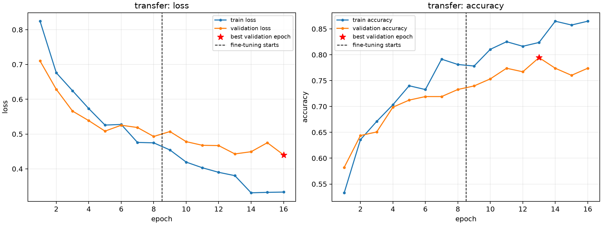

**Figure 2.3.** Training and validation curves for the frozen and fine-tuning stages. The dashed line marks the transition to fine-tuning and the star marks the best validation point. The exact trainable-layer list is saved in [`evidence/task_2/transfer_trainable_layers.json`](evidence/task_2/transfer_trainable_layers.json).

## 2.4 Training discipline

Python, NumPy, and TensorFlow used the fixed seed `230885`, deterministic TensorFlow operations were requested, and fixed split manifests were used. Both models used early stopping on validation loss with best-weight restoration, best-only model checkpoints, and learning-rate reduction after a validation-loss plateau.

The baseline ran for 15 epochs and reached its lowest validation loss at epoch 14 (`0.5778`); its highest recorded validation accuracy was `0.6918`. The two-stage transfer model ran 8 frozen epochs and 8 fine-tuning epochs. Its best overall epoch was 16, with validation loss `0.4401` and best validation accuracy `0.7945`.

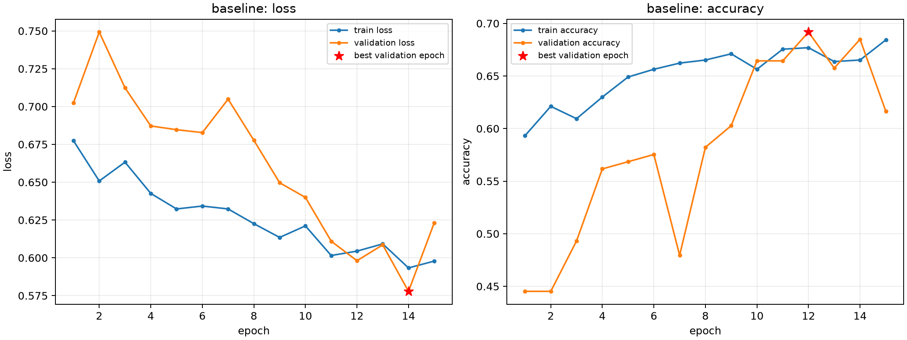

**Figure 2.4.** Baseline loss and accuracy curves with the best validation epoch marked. The gap between training and validation behavior is monitored to identify overfitting.

## 2.5 Final evaluation

The held-out test split was evaluated once, after all model development and tuning. A decision threshold was selected independently for each model using validation data only. The validation objective minimized `2 x false positives + false negatives`, because incorrectly calling an authentic image fake is considered the more harmful product error. This conservative choice increases precision at the expense of recall.

| Model | Threshold | Accuracy | Precision | Recall | F1 | ROC-AUC | TN | FP | FN | TP |
|---|---:|---:|---:|---:|---:|---:|---:|---:|---:|---:|
| Baseline CNN | 0.635 | 0.578 | 0.828 | 0.296 | 0.436 | 0.746 | 61 | 5 | 57 | 24 |
| MobileNetV2 | 0.825 | 0.714 | 0.953 | 0.506 | 0.661 | 0.891 | 64 | 2 | 40 | 41 |

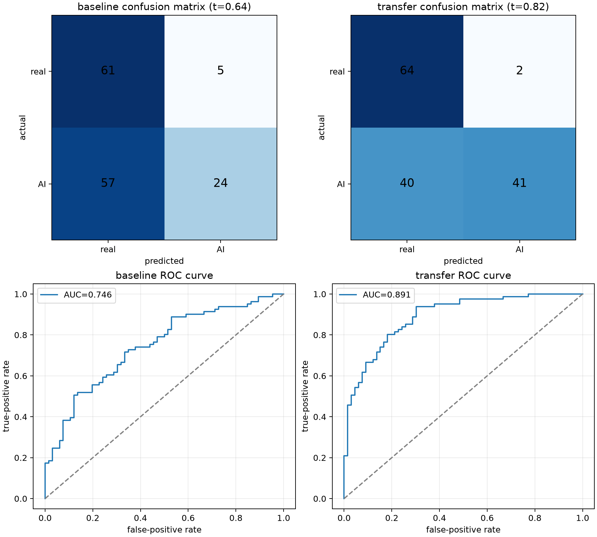

**Figure 2.5.** Final confusion matrices and ROC curves. MobileNetV2 substantially outperformed the baseline and reduced false accusations of real images from five to two, although its conservative threshold missed 40 AI-generated images.

## 2.6 Error analysis

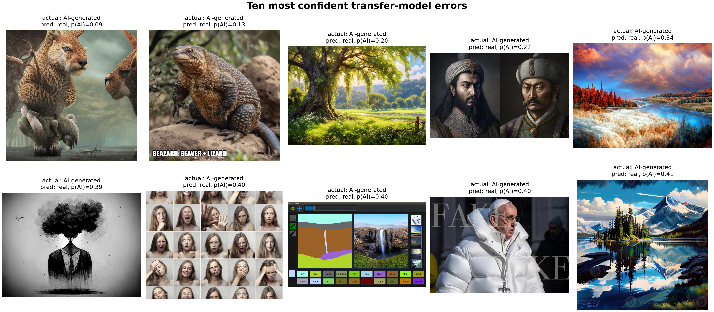

**Figure 2.6.** The ten most confident MobileNetV2 mistakes were all AI-generated images classified as real at the conservative `0.825` threshold. The image-specific hypotheses, ordered left-to-right across the top row and then the bottom row, are:

1. The hybrid leopard image has coherent fur texture and photographic depth of field despite its impossible anatomy.
2. The beaver-lizard image resembles a wildlife photograph, and the overlaid caption may be interpreted as ordinary meme text rather than a generation artifact.
3. The sunlit tree scene has consistent perspective and natural-looking global illumination, although it is painterly.
4. The paired historical portraits have plausible faces, clothing texture, and studio-style backgrounds.
5. The autumn landscape has coherent reflections and composition similar to heavily edited landscape photography.
6. The monochrome tree-person artwork is intentionally stylized, so its artificial cues resemble conventional illustration rather than generative defects.
7. The facial-expression collage contains many locally realistic face crops; global collage structure is not captured well by a lightweight classifier.
8. The scene-design software screenshot is a real-looking user interface even though the content shown inside it is generated.
9. The pope-in-a-puffer image has convincing facial identity and lighting; the semantic absurdity requires higher-level contextual reasoning.
10. The watermarked mountain illustration contains stock-image-style watermarks and clean graphic shapes that can occur in authentic digital artwork.

The corresponding paths and probabilities are recorded in [`evidence/task_2/misclassified_10.csv`](evidence/task_2/misclassified_10.csv).

## 2.7 Keras Tuner lab

The toy lab used KerasTuner RandomSearch on a fixed 6,000-image Fashion-MNIST subset. Four trials searched dense-layer width, dropout, and learning rate. The applied VisionGuard search completed eight trials over learning rate, dropout, and the number of unfrozen MobileNetV2 layers.

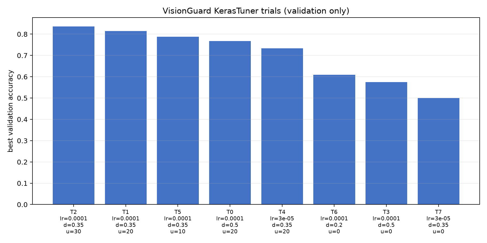

**Figure 2.7.** Validation accuracy across the eight VisionGuard trials. The best trial achieved `0.8356` validation accuracy with learning rate `1e-4`, dropout `0.35`, and 30 unfrozen layers. The trial table is stored in [`evidence/task_2/vision_tuner_trials.csv`](evidence/task_2/vision_tuner_trials.csv).

The winning configuration suggests that learning rate and fine-tuning depth mattered: a moderate `1e-4` update rate with a deeper unfrozen tail adapted pretrained features while dropout controlled overfitting. However, selecting the maximum from repeated validation trials can itself overfit the validation set. Therefore, `0.8356` is a model-selection score rather than an unbiased generalization estimate; only the untouched test result in Section 2.5 is reported as final performance.

---

# Task 3: Experiment Tracking with MLflow and DagsHub

## 3.1 Tool lab: MLflow locally

A local MLflow experiment named `task_3_1_fashion_mnist_toy` was created with a SQLite metadata backend (`mlflow.db`). A fixed subset of Fashion-MNIST was used: 5,000 training examples and a disjoint 1,000-example validation set. Both runs used the same seed (`230885`), 64-unit dense architecture, Adam optimizer, batch size 128, dropout 0.25, and five epochs. Only the learning rate changed, making the runs directly comparable.

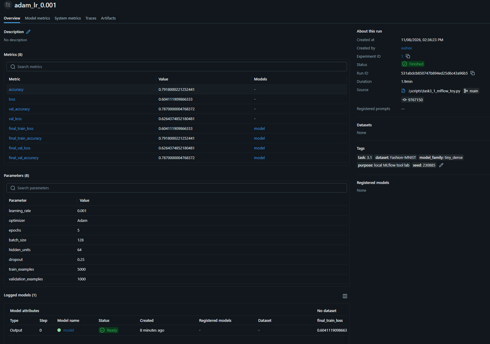

**Figure 3.1.** MLflow run `531abdcb850747b894ed25d6c43a96b5` using learning rate `0.001`. The run page records parameters, tags, per-epoch metrics, final metrics, source revision, and the logged Keras model. It reached validation accuracy `0.7870` and validation loss `0.6264`.

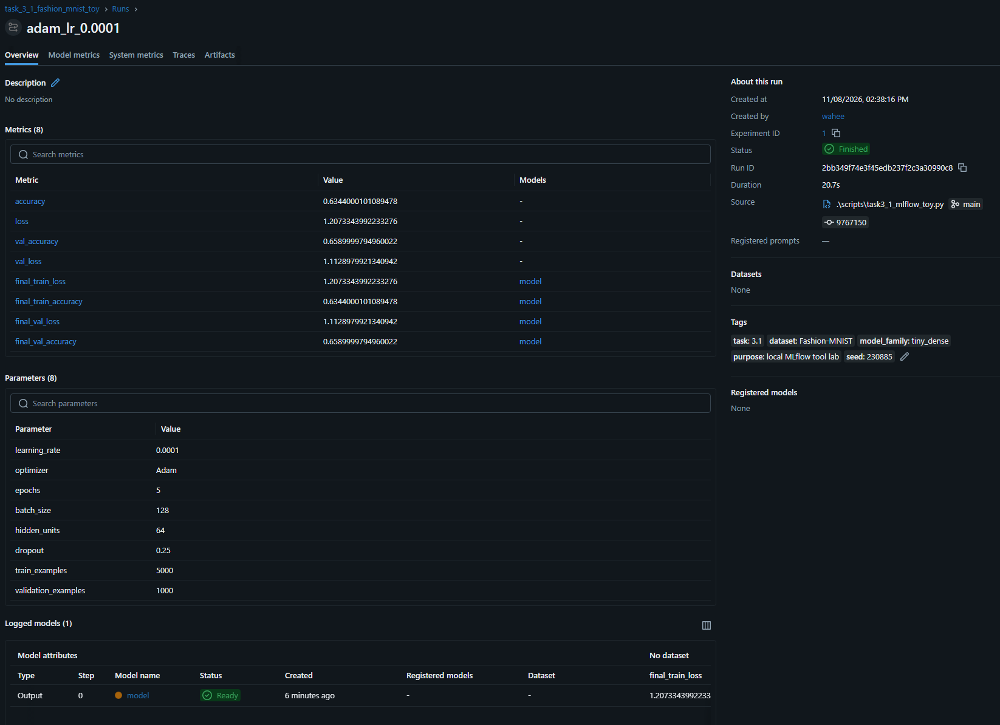

**Figure 3.2.** MLflow run `2bb349f74e3f45edb237f2c3a30990c8` using learning rate `0.0001`. With all other settings fixed, it reached validation accuracy `0.6590` and validation loss `1.1129`, showing that it learned too slowly within five epochs.

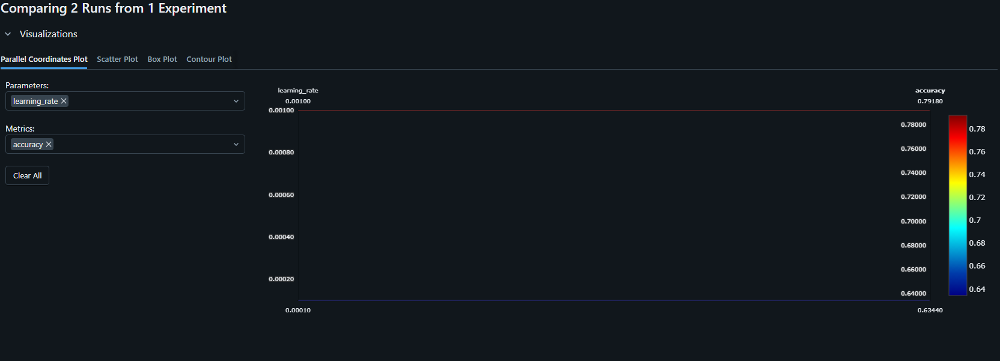

**Figure 3.3.** MLflow comparison view for both runs. The `0.001` learning rate produced final training accuracy `0.7918`, compared with `0.6344` for `0.0001`, and it also produced the better validation result. Therefore, `0.001` is the better of the two tested learning rates for this fixed five-epoch lab.

### MLflow terminology

- **Experiment:** a named container that groups related runs; here it groups the two Fashion-MNIST learning-rate trials.
- **Run:** one execution of the training program with its own ID, start/end status, inputs, outputs, and metadata.
- **Parameter:** an input/configuration value fixed for a run, such as learning rate, optimizer, batch size, dropout, or epoch count.
- **Metric:** a numeric measurement recorded during or after a run. Metrics can vary by step; this lab logs loss, accuracy, validation loss, and validation accuracy after every epoch plus final values.
- **Artifact:** an output file or directory retained with a run, such as the training-curve figure, JSON summary, or serialized Keras model.
- **Tag:** searchable descriptive metadata used to organize runs. These runs include `task: 3.1`, `dataset: Fashion-MNIST`, `model_family: tiny_dense`, `purpose: local MLflow tool lab`, and the random seed.

The complete reproducible implementation is in [`scripts/task3_1_mlflow_toy.py`](scripts/task3_1_mlflow_toy.py). Local MLflow state (`mlflow.db`, `mlruns/`, and `mlartifacts/`) is git-ignored so experiment data and generated models are not accidentally committed.

## 3.2 DagsHub setup and remote toy run

The existing DagsHub repository, `waheedsarem/23L-0885_A2_Ops`, is connected to the Git project and already contains the DVC-tracked dataset from Task 1.4. Its hosted MLflow tracking endpoint is `https://dagshub.com/waheedsarem/23L-0885_A2_Ops.mlflow`.

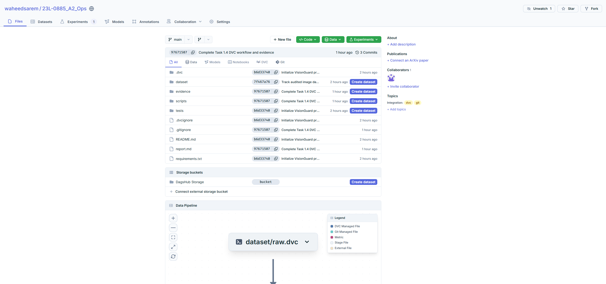

**Figure 3.4.** DagsHub project page showing the repository files, Git commit, DVC-managed dataset, storage, and Experiments integration.

Authentication is provided only through the environment variables `MLFLOW_TRACKING_URI`, `MLFLOW_TRACKING_USERNAME`, and `MLFLOW_TRACKING_PASSWORD`. The password variable contains a DagsHub access token. The token is never embedded in Python code or committed to Git. `.env.example` documents the required variable names with a placeholder, while the real `.env` is ignored.

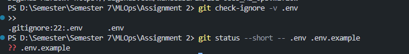

**Figure 3.5.** `git check-ignore -v .env` proves that `.gitignore` excludes the credential file. `git status --short -- .env .env.example` shows only the safe `.env.example` template; the real `.env` is absent from Git status.

The best local Task 3.1 configuration was repeated against DagsHub using `scripts/task3_2_dagshub_toy.py`. Remote run `67ce98df886746c5a699538d60610e19` used Adam, learning rate `0.001`, batch size 128, dropout 0.25, 64 hidden units, and five epochs. It achieved training accuracy `0.7864`, validation accuracy `0.7740`, training loss `0.6234`, and validation loss `0.6415`. These results are close to the corresponding local run (`0.7870` validation accuracy), supporting reproducibility across tracking backends.

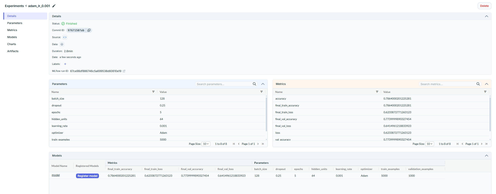

**Figure 3.6.** DagsHub-hosted MLflow run showing the finished status, Git commit, run ID, parameters, metrics, and logged Keras model. The run is accessible from the project’s Experiments tab.

The safe configuration template is in [`.env.example`](.env.example), and the reproducible remote-run implementation is in [`scripts/task3_2_dagshub_toy.py`](scripts/task3_2_dagshub_toy.py).

## 3.3 Instrument VisionGuard training

Six VisionGuard runs were recorded in the DagsHub experiment `VisionGuard_controlled_experiments`. Every run logs the fixed seed (`230885`), Git commit, DVC dataset hash, model family, logging approach, hyperparameters, and best validation metrics. The canonical baseline run also records the already-computed final test metrics from Task 2; the test set was not evaluated again.

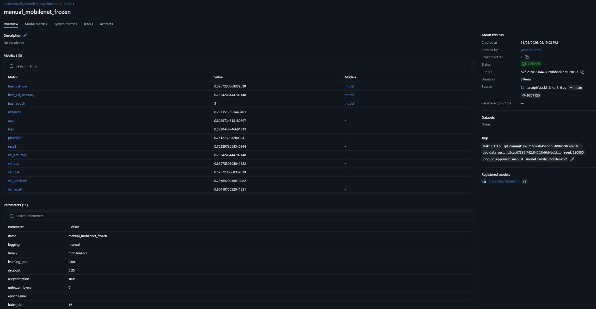

**Figure 3.7.** Manually instrumented frozen MobileNetV2 run. A custom Keras callback logs every epoch's loss, accuracy, precision, recall, AUC and validation counterparts. The run page also shows parameters, Git/DVC/seed tags, best epoch 5, best validation accuracy `0.7534`, validation loss `0.5267`, and validation AUC `0.8198`.

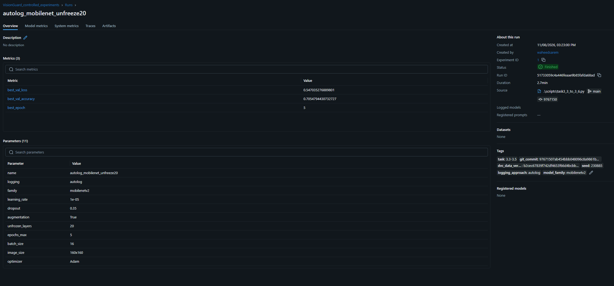

**Figure 3.8.** MobileNetV2 run instrumented with `mlflow.tensorflow.autolog()`, with the last 20 layers eligible for fine-tuning at learning rate `1e-5`. The shared explicit logger also preserved configuration, tags, artifacts, and summary metrics. It reached validation accuracy `0.7055` and validation loss `0.5470`.

The manual callback gives precise control: it reliably captured all requested epoch metrics and the Keras model, but every desired item must be explicitly coded and maintained. TensorFlow autologging requires less instrumentation and attempted to capture training automatically. In this environment it captured the training context but DagsHub returned `INVALID_PARAMETER_VALUE` during autolog's automatic model upload, so the autologged run lacks the full metric/model linkage visible on the manual run. This is a concrete limitation of relying only on autologging across backend/version combinations. Explicit common logging ensured the parameters, tags, best metrics and report artifacts were still retained.

## 3.4 Run artifacts

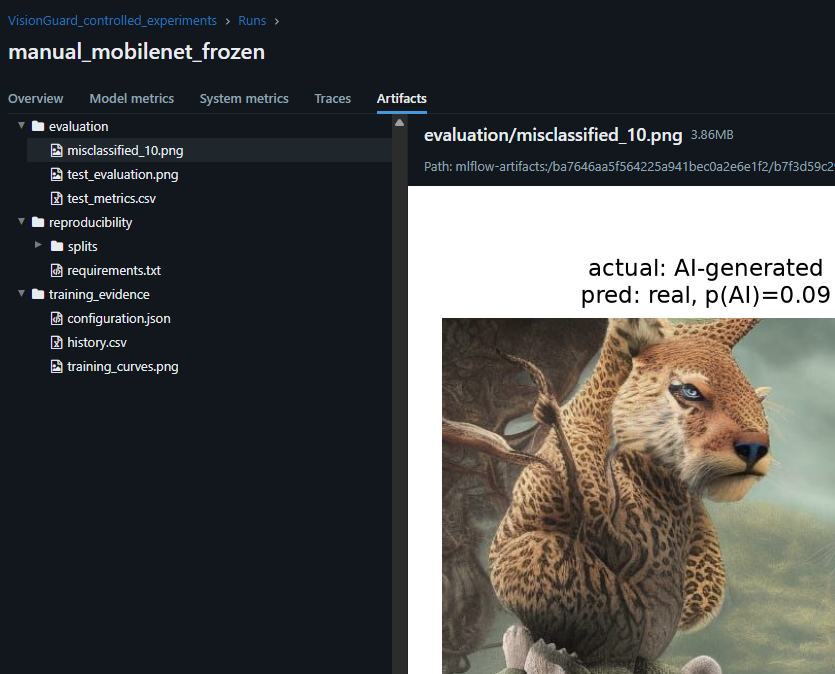

**Figure 3.9.** Artifacts attached to the selected MobileNetV2 run. `evaluation/` contains the confusion matrix and ROC figure, test metrics and ten-image error analysis; `reproducibility/` contains the exact split manifests and package requirements; and `training_evidence/` contains configuration, epoch history and learning curves. The serialized Keras model is linked from the run overview and was subsequently registered as model version 2.

The packaged evidence means a reviewer can connect results to the exact data split, environment, source commit and model artifact instead of relying only on screenshots or terminal output.

## 3.5 Experiment comparison

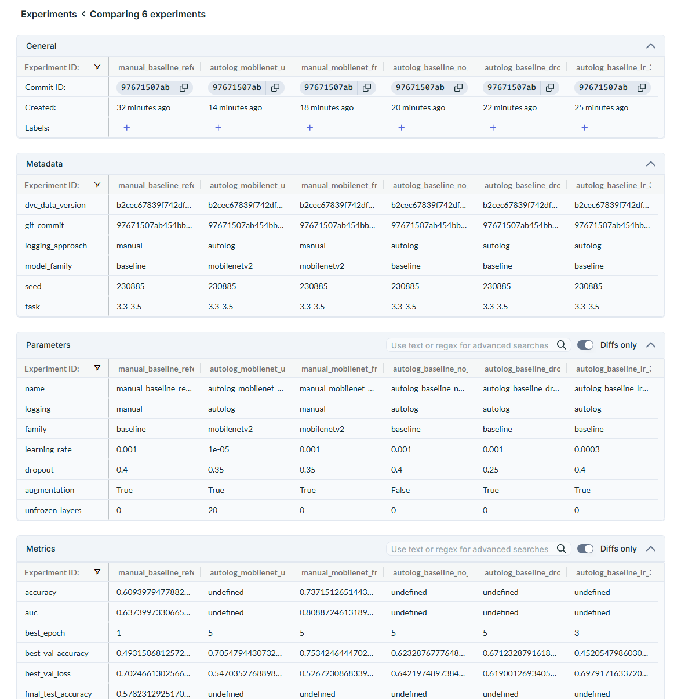

**Figure 3.10.** Side-by-side comparison of all six runs, including source/data tags, logging approach, family, learning rate, dropout, augmentation, unfrozen layers and validation metrics.

| Run | Meaningful change | Best validation accuracy | Best validation loss |
|---|---|---:|---:|
| `manual_baseline_reference` | Reference baseline, LR `1e-3` | 0.4932 | 0.7025 |
| `autolog_baseline_lr_3e-4` | Learning rate reduced to `3e-4` | 0.4521 | 0.6979 |
| `autolog_baseline_dropout_025` | Dropout reduced to `0.25` | 0.6712 | 0.6190 |
| `autolog_baseline_no_augmentation` | Training augmentation disabled | 0.6233 | 0.6422 |
| `manual_mobilenet_frozen` | Backbone changed to frozen MobileNetV2 | **0.7534** | **0.5267** |
| `autolog_mobilenet_unfreeze20` | Last 20 MobileNetV2 layers eligible for fine-tuning | 0.7055 | 0.5470 |

The frozen MobileNetV2 run is selected as the best controlled experiment because it has both the highest validation accuracy and lowest validation loss. It also exceeds the best baseline variant by about 8.2 percentage points in validation accuracy. Within the short five-epoch budget, unfreezing the final 20 layers did not help: the very small `1e-5` learning rate and increased optimization difficulty likely needed more epochs. Reducing baseline dropout helped substantially, whereas reducing learning rate hurt short-budget learning. Disabling augmentation improved on the reference in this short run but is not automatically preferable for generalization, because a small validation set can reward a less regularized configuration.

## 3.6 Model registry and champion loading

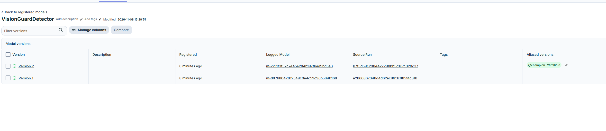

**Figure 3.11.** DagsHub/MLflow registry for `VisionGuardDetector`. Version 1 points to the manually logged baseline model. Version 2 points to the selected frozen MobileNetV2 model and carries the `champion` alias.

The script `scripts/predict_champion.py` loads `models:/VisionGuardDetector@champion`, so application code does not hard-code a version number. Promoting a future registry version only requires moving the alias; the prediction code remains unchanged.

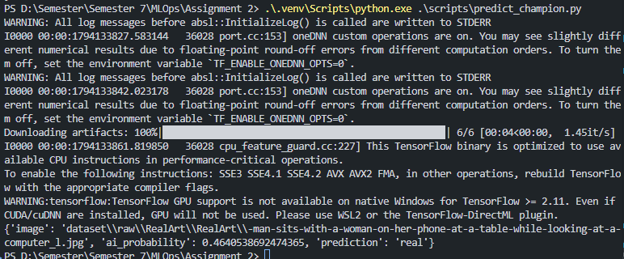

**Figure 3.12.** Terminal proof that MLflow downloaded the champion artifacts and classified one image. For `-man-sits-with-a-woman-on-her-phone-at-a-table-while-looking-at-a-computer_1.jpg`, the champion produced AI probability `0.4641` and classified it as real, matching its true class.

The full experiment runner is [`scripts/task3_3_to_3_6.py`](scripts/task3_3_to_3_6.py), registry recovery/finalization is [`scripts/finalize_task3_registry.py`](scripts/finalize_task3_registry.py), and alias-based inference is [`scripts/predict_champion.py`](scripts/predict_champion.py).

---

# Task 4: Flask Web Application

## 4.1 Inference module

`webapp/inference.py` defines a separate `InferenceService`. The champion Keras model is loaded once when the Flask process starts, not inside the request handler. Each uploaded image is decoded from memory, verified with Pillow, converted to RGB float values in the `[0,255]` range, resized to `160 x 160` with TensorFlow `resize_with_pad` and antialiasing, and batched. This exactly matches the Task 2 serving-relevant preprocessing; MobileNetV2 scaling remains inside the saved model. The service returns the verdict, class confidence, AI probability and validation-selected threshold (`0.825`).

Loading a model on every request is unacceptable because it repeatedly performs disk/network I/O, allocates model weights, increases latency and memory pressure, and creates concurrency failures under load. It would also make availability depend on DagsHub for every prediction. The deployment plan is therefore: download/promote the registry champion during release, place the immutable `.keras` file on the server, set `MODEL_PATH`, and load it once at process startup.

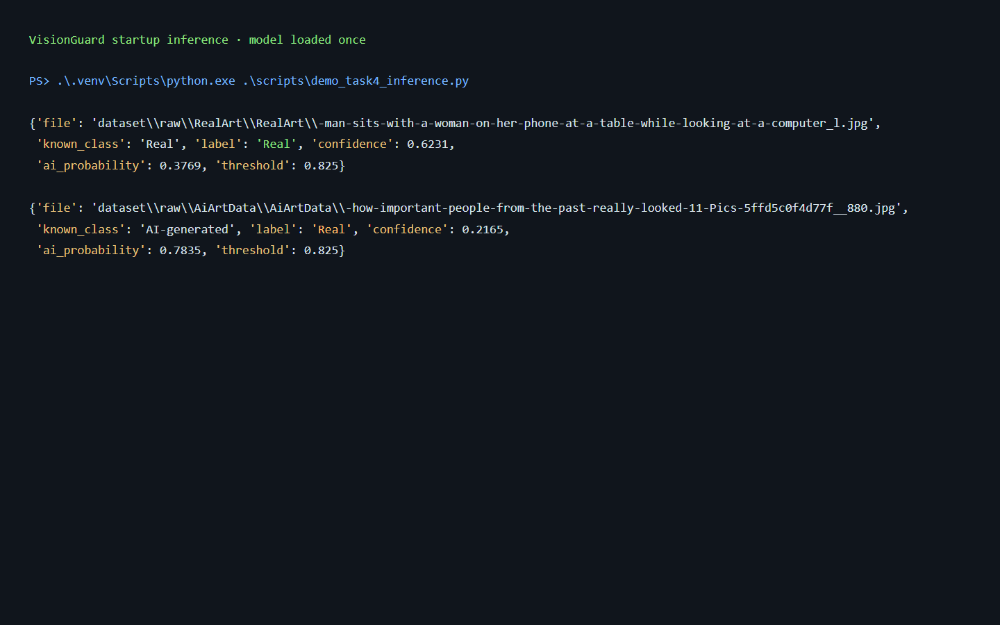

**Figure 4.1.** Console evidence for one known real and one known AI-generated image. The real image was correctly classified with `62.3%` confidence. The AI-generated image received AI probability `0.7835` but remained below the deliberately conservative `0.825` threshold, so it was labelled real with low confidence. This error is reported honestly and is consistent with Task 2's high-precision/low-recall operating point.

## 4.2 Routes, validation and history

The application provides `GET /`, `POST /predict`, `GET /history`, and `GET /health`. Upload validation checks that a file exists, sanitizes its name with `secure_filename`, permits only JPG/PNG/WebP extensions and MIME types, enforces the environment-configured size limit, and verifies that Pillow can decode the content. Bytes are held only in memory and never written to disk. SQLite stores only timestamp, sanitized filename, verdict, confidence, AI probability and threshold.

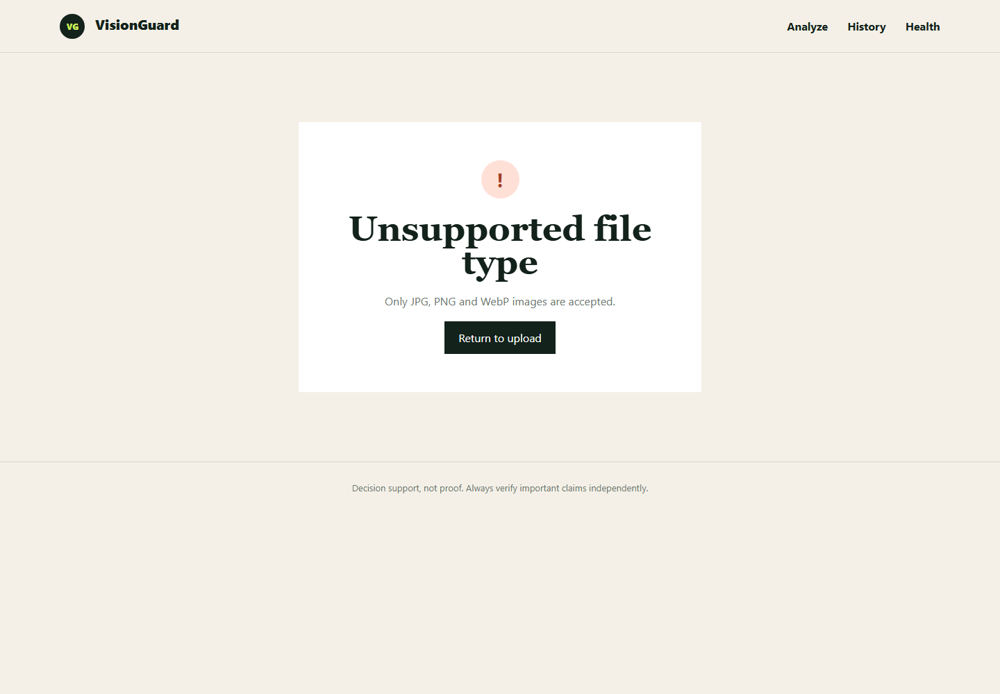

**Figure 4.2.** A `.txt` upload is rejected with HTTP 400 and a friendly supported-format message.

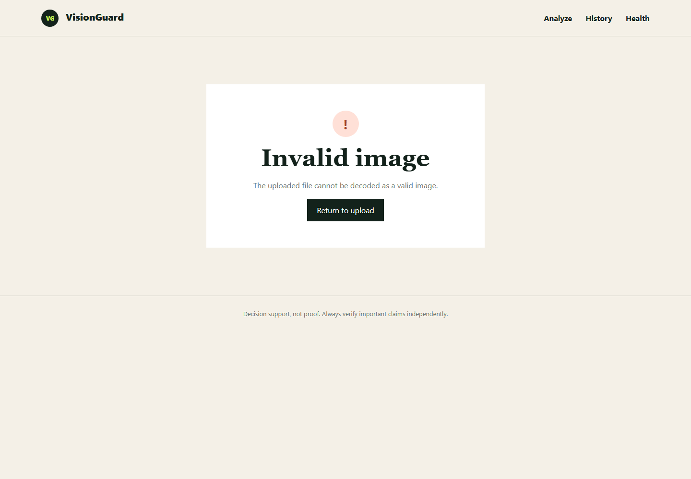

**Figure 4.3.** A file named and typed as PNG but containing invalid bytes is rejected with HTTP 400 after decode verification.

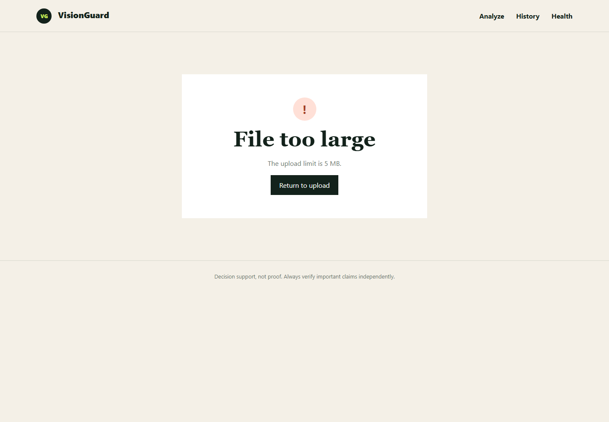

**Figure 4.4.** A six-megabyte upload exceeds the configured five-megabyte limit and receives a friendly HTTP 413 page.

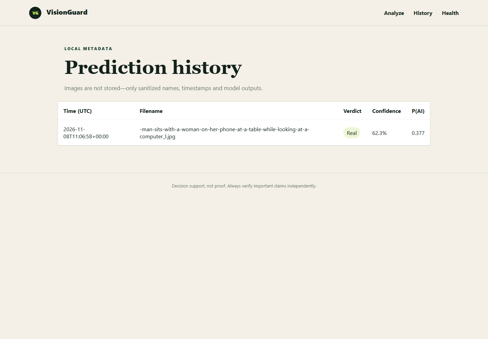

**Figure 4.5.** Database-backed history shows model metadata only. The original image is not retained.

Five automated Flask tests cover health, a valid upload/history record, filename sanitization, wrong type, fake image content and the size limit; all five pass.

## 4.3 HTML and CSS frontend

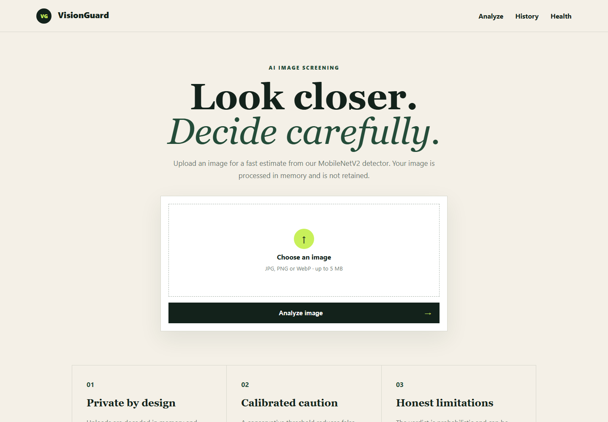

**Figure 4.6.** Responsive upload interface with clear format/size guidance, privacy statement, navigation and an explicit limitations section.

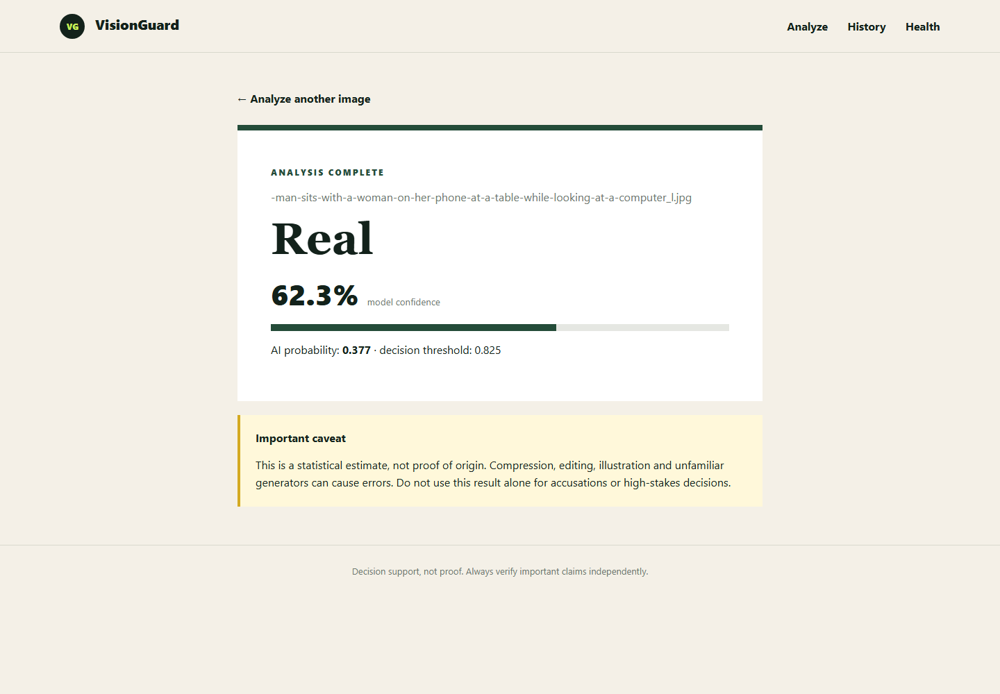

**Figure 4.7.** Result page showing verdict, confidence, raw AI probability, threshold and an honest caveat that the output is statistical evidence rather than proof.

The Jinja templates share a common navigation/footer layout. CSS uses a responsive editorial design and collapses the three explanatory panels to one column on small screens. The History menu reads prediction metadata from SQLite on demand.

## 4.4 Configuration and production server

All operational settings are read from environment variables: `MODEL_PATH`, `MODEL_THRESHOLD`, `DATABASE_PATH`, `MAX_UPLOAD_BYTES`, `MAX_HISTORY`, `APP_HOST`, `APP_PORT`, and `APP_THREADS`. Safe placeholders/defaults are documented in `.env.example`; secrets remain in the ignored `.env` file.

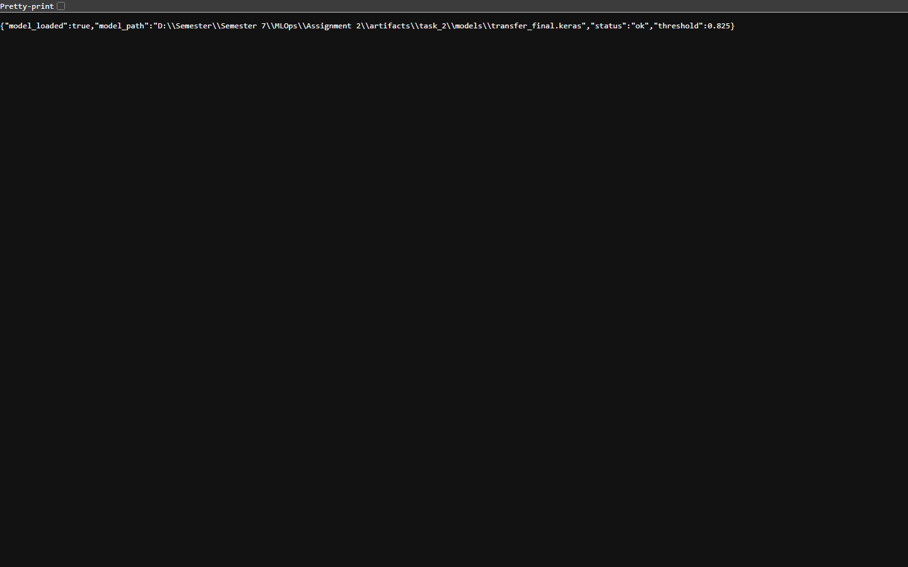

**Figure 4.8.** Live `/health` response from the production server: status is `ok`, the local champion model is loaded, and threshold `0.825` is active.

For local Flask execution, `run_flask.py` explicitly sets `debug=False`. Production uses `serve.py` with Waitress and four configurable worker threads. Debug mode is disabled in production because the interactive debugger can expose code and execute arbitrary commands, while the reloader can start duplicate model-loading processes. Waitress provides a stable multi-threaded WSGI server instead of Flask's development server.

Run locally with:

```powershell
.\.venv\Scripts\python.exe .\run_flask.py
```

Run the production server with:

```powershell
.\.venv\Scripts\python.exe .\serve.py
```

The verified live routes returned HTTP 200 for `/`, `/history`, and `/health`; validation returned HTTP 400, 400 and 413 for the three required failure cases. The detailed checks are saved in `evidence/task_4/live_route_checks.json`.
